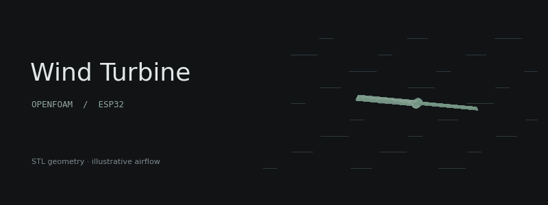

# Wind Turbine


Estudo de uma turbina eólica de bancada com simulações transientes e estacionárias em OpenFOAM. A aquisição experimental usa ESP32, sensor Hall e INA219 para acompanhar rotação, tensão, corrente e potência elétrica em uma dashboard local, com histórico de ensaios e exportação em CSV.



## Estrutura

| Pasta | Conteúdo |
| --- | --- |
| [simulations/pimplefoam](simulations/pimplefoam/README.md) | Simulação transiente com rotação livre |
| [simulations/simplefoam](simulations/simplefoam/README.md) | Simulação estacionária com rotação prescrita — MRF |
| [dashboard](dashboard/README.md) | Gráficos, aquisição USB, histórico e exportação CSV |
| [firmware](firmware/README.md) | ESP32, INA219, sensor Hall e LED de gravação |
| [docs](docs/README.md) | Animação da hélice e script de geração |
| [archive](archive/README.md) | Arquivos do trabalho anterior |

## Requisitos

| Componente | Dependências |
| --- | --- |
| Dashboard | Node.js 22+ e npm |
| Firmware | Python e PlatformIO, ou extensão PlatformIO no VS Code |
| Simulações | Linux, OpenFOAM 2512, MPI e dependências Python |

Para usar as simulações ou o PlatformIO, instale as dependências Python a partir da raiz:

```bash
python3 -m venv .venv
source .venv/bin/activate
python3 -m pip install -r requirements.txt
```

<details>
<summary>Windows PowerShell</summary>

```powershell
py -m venv .venv
.\.venv\Scripts\Activate.ps1
python -m pip install -r requirements.txt
```

</details>

`requirements.txt` reúne as dependências Python. Node.js, OpenFOAM e MPI são instalados separadamente; os pacotes JavaScript são instalados pelo npm.

## Dashboard

Execute da raiz:

```bash
cd dashboard
npm ci
npm start
```

Abra **[localhost:8765](http://127.0.0.1:8765)**. Encerre o servidor com <kbd>Ctrl</kbd> + <kbd>C</kbd>.

> [!TIP]
> Instale com `npm ci` apenas na primeira execução ou quando as dependências mudarem. No uso diário, execute `npm start`.

Selecione **USB · ESP32** para medir ou **Demo** para visualizar dados gerados. Informe o nome do ensaio antes de gravar; os CSVs ficam em `dashboard/data/` e aparecem no histórico lateral.

## Firmware

Com o ambiente Python ativo, execute da raiz:

```bash
pio run -d firmware
pio device list
```

Para gravar, substitua a porta pelo dispositivo identificado:

```bash
pio run -d firmware -t upload --upload-port /dev/ttyUSB0
```

> [!IMPORTANT]
> Desconecte a dashboard da porta USB e feche o Monitor Serial antes de gravar. Apenas uma aplicação pode usar a porta por vez.

O firmware permanece no ESP32 após a gravação. GPIOs e sensores estão definidos em [hardware_config.h](firmware/include/hardware_config.h).

## Simulações

Execute da raiz:

```bash
cd simulations/pimplefoam
source /usr/lib/openfoam/openfoam2512/etc/bashrc
./run_mpi.sh 6
```

Para o caso estacionário, use `simulations/simplefoam/`. Edite o `config.yaml` do caso antes de executar. Cada caso preserva seu histórico em `runs/`; os detalhes das etapas ficam nos logs.

A simulação calcula potência aerodinâmica; a bancada mede potência elétrica. A integração automática entre as duas frentes ainda não foi implementada.

## Compatibilidade

A dashboard e as ferramentas do firmware têm suporte a Linux, Windows e macOS. Este projeto foi validado no Linux; outros sistemas podem exigir driver USB e permissão para a porta. Consulte os READMEs de [dashboard](dashboard/README.md) e [firmware](firmware/README.md).
